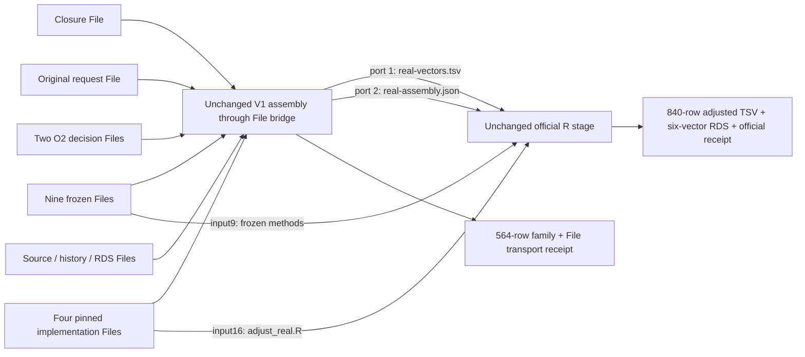

# A real-intake V1 explicit File DAG candidate

This directory is a reviewable transport candidate. It does not register a
resident plugin, execute a native SDK DAG, change any frozen source, extend the
old family publisher's receipt acceptance, or grant finite primary qualification.
The existing V1 interface still records 275 pending decisions and one
`LOCKED_O2_PRIMARY_NA`. All missing primary adjustment-one placeholders retain
their existing meaning; they are not scientific negative results.

## File contract and graph

The SDK currently exposes fixed `File` inputs in plugin manifests. The runtime
can stage FileSets, but `PortKind` in `crates/container-plugin/src/node_definition.rs`
accepts only `file`; this candidate does not pretend a JSON list is a FileSet.
`prepare.py` therefore derives a request-specific, exhaustive set of ordinary
File ports. It produces two loadable manifest candidates and a separate native
`dag_core::dag::history::DagManifest` shaped file. Each request produces a new
manifest identity requiring review. Do not install `manifest.template.toml`.

| Assembly input port | File role |
| --- | --- |
| 0 | Exact closure contract, whose SHA is recorded in the candidate |
| 1–9 | Nine frozen source files, in original source-lock order |
| 10 | Original, unmodified V1 request |
| 11–12 | O2 input-card and harmonization decision evidence |
| 13–16 | Pinned original family helper, replay history validator, V1 intake and V1 official R program |
| 17 onward | Unique source/history/RDS files, ordered by original canonical path |

The request's original paths are provenance labels. The bridge never opens them
inside the consumer. It reads only `AUTONOMICS_INPUTn`, checks exact role/order,
SHA and byte counts, and reconstructs the frozen relative directory structure.
That reconstruction is necessary because unchanged `intake.py` resolves the two
O2 decision files relative to frozen source 0. Sources, history and opaque input
RDS are copied to private canonical files with mode 0444, and a separate derived
request names those files. `file-transport.json` preserves original paths/SHA,
port numbers, materialized paths/SHA, original request SHA, materialized request
SHA and assembly output hashes. The existing assembly receipt is not rewritten
to impersonate the original request or an old official result.



The official stage has four inputs in order: vectors, assembly receipt, frozen
R methods and the sealed `adjust_real.R` File. `adjust.sh` verifies both executable
R source hashes and stops on nonzero R exit before publishing any of its three
output ports. It runs the original program with `Rscript --vanilla`; there is no
new correction formula. The R manifest pins the current existing official image
`ghcr.io/zj-2002/mrlap-official@sha256:e6e10cddfa1cba8046ee6fbc1492b94cbd70d66b097f5f415845d56f9f925434`.
Its runtime preflight remains pending: R/stats 4.6.1, jsonlite, sh, sha256sum, cut
and cp must actually be available. Availability is not inferred from a digest
string. The Python manifest reuses the existing pinned official Python 3.14.7
image. Neither image was built, pulled or executed in this round.

## Candidate preparation and isolated import handoff

Use the managed lifecycle for preparation because it creates a generated source
copy. Scientific input paths remain canonical and outside disposable scratch;
the generated candidate and mandatory technical evidence belong under the
managed permanent namespace. The following is a command template, not an
executed real-data request:

```text
python3 -B scripts/research_validation_session.py run -- python3 -B /ABS/plugins/research-adapters/frozen-a-real-intake-dag-v1/prepare.py --request /ABS/REQUEST.json --study-root /ABS/FROZEN_STUDY --adapters-root /ABS/plugins/research-adapters --output /ABS/NEW_MANAGED_PERMANENT_CANDIDATE
```

Generated files are `file-closure.json`, `dag-candidate.json`,
`native-dag-manifest.json`, `assembly/{manifest.toml,bridge.py}` and
`official/{manifest.toml,adjust.sh}`. `source-lock.json` is embedded as a literal
`command.files` payload in the generated assembly manifest; no ambient host
source-lock path is needed by the container. Both generated manifests retain
`stage_in_mode="copy"`, isolated network, read-only root filesystem, one CPU,
1 GiB memory, PID limit 64 and pull-never policy.

`dag-candidate.json` is review metadata plus the explicit node/edge recipe.
`native-dag-manifest.json` contains only native schema version, nodes and edges;
its shape was checked against the current Rust declarations, not deserialized
by a running SDK. For later integration, an isolated harness must load the two
generated plugin manifests, inline and SHA-bind their adjacent scripts using the
existing loader, register `file_reference`, then build each node with
`NodeRegistry::build_node`/`DAG::add_node_with_spec` and add the recorded edges
with `DAG::add_edge`. Require content hashing and copied staging. Keep the
generated manifests, scripts, closure and native graph SHA-bound in that
harness's admission contract. Existing sealed dedicated frozen-family probes
pin old kinds/manifests/topologies; do not relabel this candidate to pass those
admission guards. A dedicated admission extension or another reviewed isolated
runner is still required before claiming an SDK DAG proof.

The generated native graph references the original canonical input paths for
the host-side `file_reference` producer. Container consumers receive staged
Files, not those host path strings. The later harness may instead bind explicit
read-only VFS roots without changing port roles. No production configuration,
registry, cache entry, service or old receipt parser is changed here.

## Real engineering limits and minimal SDK suggestion

Current native `PortId` and `EdgeEntry` ports are `u8`; the fixed assembly prefix
uses 17 inputs including the closure. This candidate therefore rejects more
than **239 unique request dependencies** before generating a manifest. Its total
source payload budget is **128 MiB**, with individual files bounded at 32 MiB.
These are candidate transport/resource limits, not changes to 276/288/696 or
any frozen scientific family. The synthetic request used here has three unique
dependencies and 20 input ports. No actual real-request closure was counted;
whether one exceeds these limits must be measured from that request, without
starting a fit or inferring from the number of edges.

For larger closures, the smallest SDK proposal is a versioned `file-set` input
kind mapped to the existing `NodeValue::FileSet`, plus an explicit hash-bound
member manifest and a producer that emits only declared Files. Existing runtime
sorting and per-member staging can then be reused. Add closed membership,
ordered identity and missing/extra/member-SHA rejection before mounting, with a
bounded aggregate payload. This avoids widening every native port identifier.
A reviewed typed bundle/packer tree with each original File explicitly upstream
is another option. No SDK, engine or shared packer was modified in this round.

## What was actually tested

Eight new incremental tests passed. Only one test invokes unchanged V1 assembly,
using synthetic observations plus copied frozen definitions. It first renames
away the request/source/history/RDS original directory, so path fallback cannot
satisfy the test. The newly materialized family and vectors are byte-identical
to the sealed 564-row and 840-row synthetic carriers. Original source/history
rows, opaque RDS identity, the two decision evidence hashes and the separate
original/materialized request identities are retained. Other cases reject a
missing File, a staged SHA mismatch, an omitted closure declaration, port
overflow and aggregate byte overflow. Port checks assert `input9` is frozen R
methods and `input16` is the sealed official R program. An inert worker exiting
23 verifies shell failure propagation with no successful output receipt.

These are direct file materialization and subprocess tests. There were **zero
new container, native SDK DAG or official R executions**. The old 10 toy tests
and official 840-value correction were not rerun. Six-vector/840-value official
RDS readback is reused only from the old sealed evidence; no new RDS is claimed.
Scheduler-level upstream failure/skip evidence and connected official R output
are still pending. The original V1 RDS/TSV numerical-concordance limitation and
missing authenticated finite-primary qualification interface remain unchanged.

## Permanent evidence and source identity

This README was added after the final tests as a documentation-only increment.
It is not part of the tested source snapshot; no calculation was rerun for this
locator. The final source map is in the verification file, and a byte-for-byte
copy of all eight tested candidate files is sealed in `candidate-source/`.

Baseline repository HEADs at assignment were main
`85dece348a0e39ac2f60e09ced2cba9d42696fcd` and plugins
`d8c06ac1c45ec042a6413f1388c6d826b0dabd33`. Both repositories already contained
uncommitted changes; actual file SHA256, not HEAD, determines tested identity.
The existing baseline session `3fddecd8263d4166888d41f582b35dca`, seal
`c555dce6ba321e9048f65b571fef841e09acfadd646e97145455fa01589fdf68`, was independently
checked for CLEANED, worker/launcher exit 0, all 20 archived file hashes and all
four current sealed V1 source hashes. Its verification SHA256 is
`275d652659276d9b245dcdb81d1c31b9a1464e805f987917d1b2e321e3a46074`.
`source-lock.json` additionally pins the current transitive family/replay
implementations needed by the new isolated materialization; that is a current
byte pin, not an expanded scientific method claim.

Final session **`dfe1e1f094054bd6add6b05e9d6cba1a`**, CLEANED, worker/launcher exit
0, **8 tests / 0 failures / 0 errors**:

- Manifest seal: `f5783c36f3abbd76222a13c2df948dda788d94e05e9c5c824f970b7164f04962`.
- Manifest: `/home/zj-normal/.local/state/autonomics/validation-archives/dfe1e1f094054bd6add6b05e9d6cba1a/artifacts/MANIFEST.json`.
- Verification: `/home/zj-normal/.local/state/autonomics/validation-archives/dfe1e1f094054bd6add6b05e9d6cba1a/artifacts/permanent/a-real-intake-file-wiring/verification.json`.
- Verification SHA256: `491ca50683c3a35608d1ca42d74d75474af06cb6892208e252246095e3402f5d`.
- All 25 final archive members were rehashed after cleanup.

The earlier six-test wiring session `7e735f76814c4c33b038468586e677ee` is retained,
seal `40c5eab50e68ef9192ade9876f42b543aef5d7c76d19b8fc1fd5e7c494428c48`, verification
SHA256 `08f2ca3e0bdb40aa2fd5513de872396705058558675e3e878d6a02d591556f30`.
It passed but predates the SDK port-limit and payload-budget corrections; the
eight-test session above is the final tested source. There were 14 total new
test executions across the two sessions, eight distinct final test cases, and
no failed session to discard.

Pending integration consists of actual Rust manifest compilation/admission,
native scheduler execution, pinned image/runtime preflight, connected official
R transport verification, and production installation by the coordinating user.
Scientific review, signatures, result-before-view eligibility for the remaining
pending edges, resolution of O2's unavailable primary, and the protocol-defined
authenticated finite-primary interface remain separate scientific prerequisites.
No G0, research qualification, service restart or production cutover occurred.
